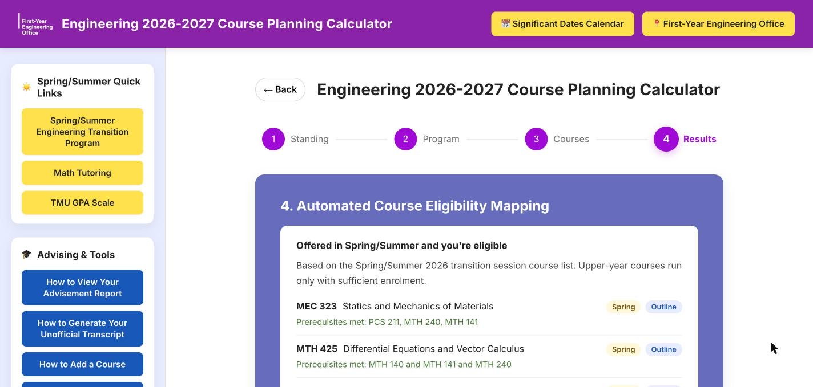

# Engineering 2026-2027 Course Planning Calculator

A web page for TMU engineering students to plan their **Spring/Summer**
courses. Students confirm their standing, pick their program and admit year,
and tick the courses they've completed. The calculator then shows:

- the Spring/Summer courses they're **eligible** for, with when each runs and
  why they qualify;
- the Spring/Summer courses they **can't take yet**, and exactly what's
  missing;
- other courses they meet the prerequisites for.

Every course links to its page in the TMU undergraduate calendar, and the
results can be printed or saved as a PDF for an advising appointment.

It's a static site (plain HTML, CSS and JavaScript) with no backend, build
step or install. Open `index.html` and it runs.



---

## Quick start

```sh
git clone https://github.com/juderozario08/2026-Course-Planning-Calculator---STAFF-BETA.git
cd 2026-Course-Planning-Calculator---STAFF-BETA
open index.html            # or double-click it
```

- After editing, hard-refresh the browser: **⌘⇧R** (Mac) / **Ctrl+Shift+R**
  (Windows).
- Add `?debug` to the URL to see which program and year were loaded.
- Optional, with [Node.js](https://nodejs.org) installed: `node scripts/check-data.js` validates the data files.

---

## Documentation

| Document | Read it if you want to… |
|---|---|
| **[User guide](docs/user-guide.md)** | use the website, or help a student use it |
| **[Architecture](docs/architecture.md)** | understand how the code works: files, data flow, state, every function |
| **[Maintaining](docs/maintaining.md)** | update courses or curricula, do the yearly update, test, or deploy |

---

## Project structure

```
index.html            Page markup
css/styles.css        All styling (matches the CEN100 Assignment Calculator)
assets/               Logo

data/                 ← what you'll edit most
  courses.js          Every course once: title, prerequisites, calendar link settings
  programs.js         Each program's curriculum per admit year
  spring-summer.js    Courses offered in the Spring/Summer transition session

js/                   Page logic
  dom.js              DOM helpers
  curriculum.js       Dropdowns, course checklist, remembered ticks
  eligibility.js      Prerequisite parser and results page
  navigation.js       Steps and browser Back/Forward
  main.js             Startup and event wiring

scripts/check-data.js Data validator (Node)
docs/                 Documentation
```

---

## Common tasks

| Task | Where | Guide |
|---|---|---|
| New intake year, curriculum unchanged | `data/programs.js`: add the year to `years` | [Recipe](docs/maintaining.md#a-new-intake-year-curriculum-unchanged) |
| Curriculum changed | `data/programs.js`: add a new version | [Recipe](docs/maintaining.md#the-curriculum-changed) |
| New or renamed course | `data/courses.js` | [Recipe](docs/maintaining.md#add-a-new-course) |
| New Spring/Summer course list | `data/spring-summer.js` | [Reference](docs/maintaining.md#dataspring-summerjs--springsummer-offerings) |
| New calendar year | Several files | [Yearly runbook](docs/maintaining.md#yearly-update-runbook) |
| Change page wording or links | `index.html`, `js/` | [Recipe](docs/maintaining.md#change-wording-on-the-page) |

---

## Contributing

1. Branch from `main`.
2. Make focused changes. Keep data and code in separate commits.
3. Run `node scripts/check-data.js` and the
   [manual test checklist](docs/maintaining.md#3-full-manual-test-checklist).
4. Open a pull request.

Conventions and deployment details are in
[maintaining.md](docs/maintaining.md#code-conventions).
