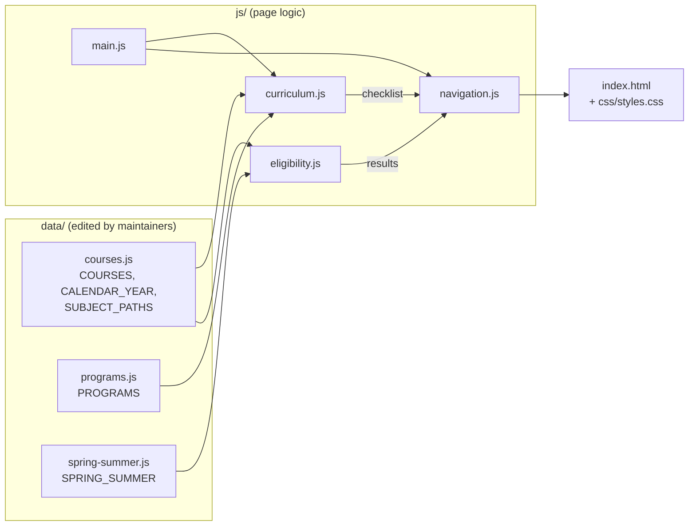
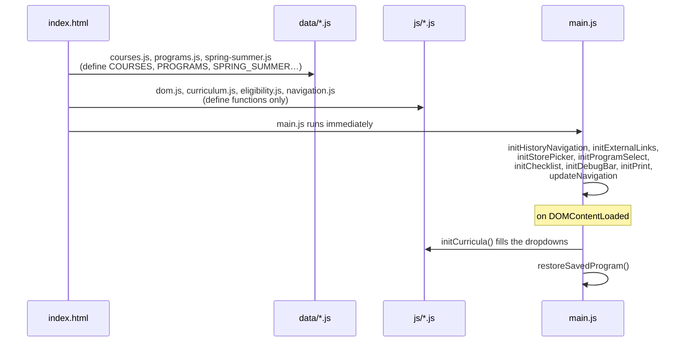
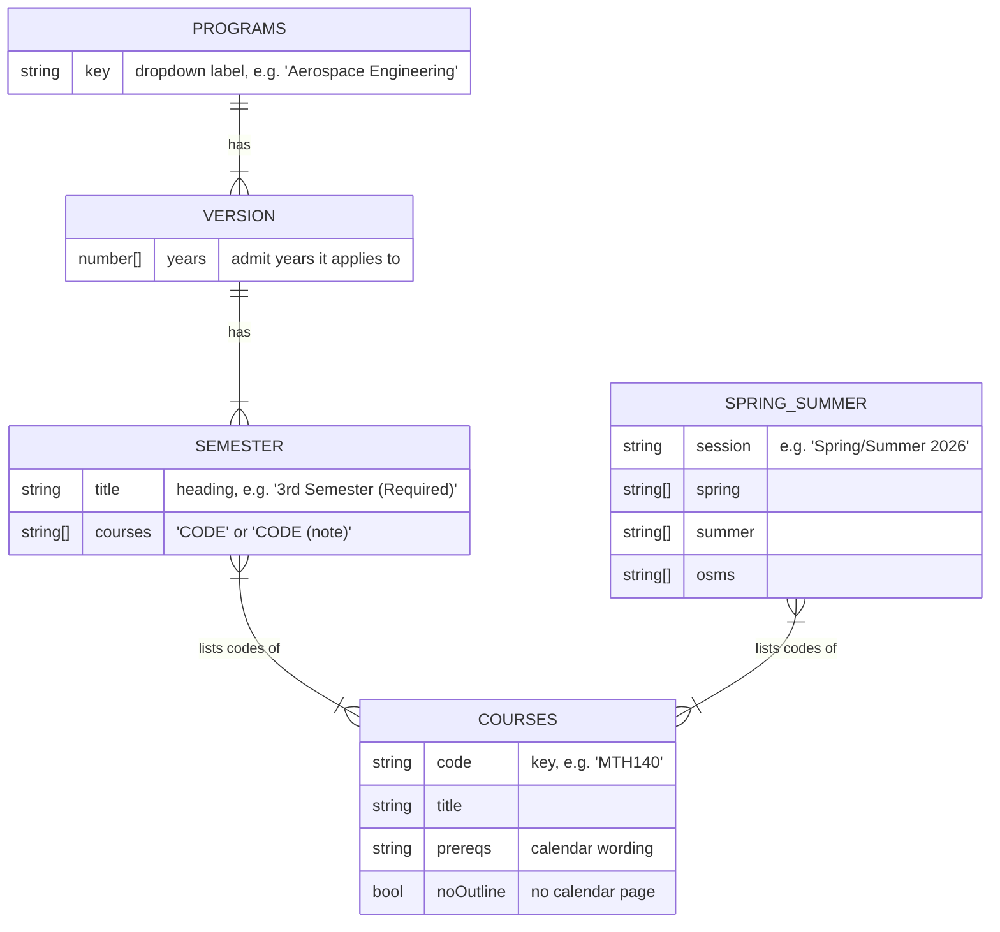
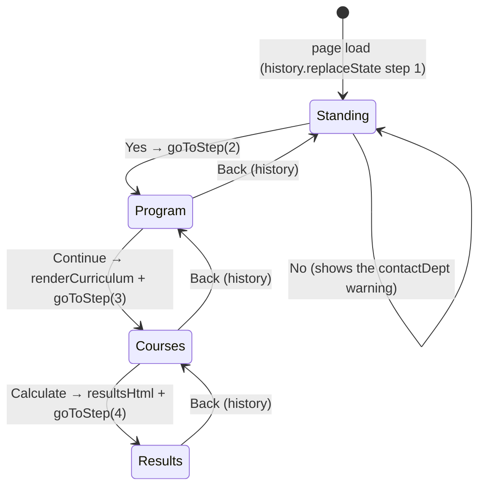
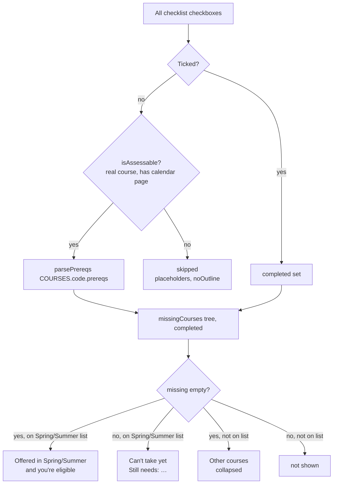

# Architecture

How the Course Planning Calculator is built. Read this before changing code.
For changing **data** (courses, curricula, offerings) see
[maintaining.md](maintaining.md).

---

## Contents

- [Overview](#overview)
- [Design decisions](#design-decisions)
- [File structure](#file-structure)
- [How the page loads](#how-the-page-loads)
- [Data model](#data-model)
- [The step flow](#the-step-flow)
- [Eligibility engine](#eligibility-engine)
- [State and storage](#state-and-storage)
- [Module reference](#module-reference)
- [Page structure (index.html)](#page-structure-indexhtml)
- [Styling](#styling)
- [External dependencies](#external-dependencies)

---

## Overview

A **static, client-side web page**: plain HTML, CSS and JavaScript, with no
framework, no build step, no backend and no network requests for data.
Everything the page needs is in the repository and runs in the browser.



The data files come from the official TMU sources: the undergraduate calendar
and the FEAS transition-session page. Logic in `js/` never hardcodes courses.

---

## Design decisions

| Decision | Why | Trade-off |
|---|---|---|
| **Plain classic `<script>` files, no modules or bundler** | The page must work when `index.html` is opened straight from disk (`file://`), and staff without dev tooling must be able to edit it. ES modules and `fetch()` are blocked on `file://`. | Shared global namespace. Script order matters, and names must not collide. |
| **Data as JavaScript files, not JSON** | Same reason: JSON would have to be fetched. A JS object literal is almost identical to JSON and loads with a `<script>` tag. | Data files can contain syntax errors. `scripts/check-data.js` catches them. |
| **Each course defined once (`COURSES`), curricula as lists of codes (`PROGRAMS`)** | The original version had 55 near-identical JSON files (only 9 distinct curricula) with titles repeated thousands of times. | Renaming a course changes it for every program and year. That's usually correct. |
| **Curriculum *versions* with a `years` list** | A new intake year with an unchanged curriculum is a one-number change. | Each year can belong to only one version per program. |
| **Prerequisites stored as the calendar's own wording** | Maintainers copy the text straight from the calendar, and a parser turns it into logic. | The parser only understands codes, *and*, *or*, commas and brackets, which covers every current calendar entry. |
| **Strings of HTML for rendering** | Small, readable, no templating dependency. | All rendered text comes from our own data files. Never render user-typed input this way. |
| **Browser history for steps** | Students expect the browser's Back button to work. | Steps 3 and 4 can't be restored after a full reload (they're rebuilt from state), so the page falls back to Step 1. |
| **`sessionStorage` for ticks, `localStorage` for program** | Ticks survive refreshes but don't linger on shared computers. The program choice is harmless to keep. | Ticks don't carry over between tabs or devices. |

---

## File structure

```
index.html              Page markup: header, sidebar, the step cards, script tags
css/styles.css          All styles: tokens, layout, components, responsive, print
assets/fyeo-logo.png    Header logo

data/
  courses.js            CALENDAR_YEAR, SUBJECT_PATHS, COURSES (course catalog)
  programs.js           PROGRAMS (curricula per program and admit year)
  spring-summer.js      SPRING_SUMMER (transition-session offerings)

js/
  dom.js                Tiny DOM helpers
  curriculum.js         Dropdowns, checklist rendering, Select all, remembered ticks
  eligibility.js        Prerequisite parser, assessment, results rendering
  navigation.js         Step switching and browser-history integration
  main.js               Event wiring and startup

scripts/
  check-data.js         Node script that validates the data files

docs/                   This documentation
README.md               Project overview and doc index
```

---

## How the page loads

The scripts are at the end of `<body>`, so the DOM exists when they run.
**Order matters:** each file uses globals defined by the files above it.



Only `main.js` has top-level side effects. Every other file just defines
constants and functions.

---

## Data model

Full field reference, with examples, is in
[maintaining.md → Data reference](maintaining.md#data-reference). In short:



Course codes are always written without a space in data (`MTH140`). They're
shown with one (`MTH 140`) via `formatCourseCode`.

---

## The step flow

The page is one HTML document with five step cards (`#step1`–`#step5`). Only
the current step is visible. Steps 4 and 5 are shown together as the
"Results" step.



- **Forward moves** call `goToStep(n)`: it shows the step and
  `history.pushState({ step: n })`.
- **Back** (the page button calls `history.back()`, or the browser's Back
  button) fires `popstate`, which calls `showStep(state.step)`.
- `canShowStep` guards against restoring Step 3 or 4 when their content no
  longer exists (e.g. browser Forward after a reload), falling back to Step 1.
- `updateNavigation` keeps the ← Back button and the stepper in sync with
  `currentStep`.

---

## Eligibility engine

Lives in `js/eligibility.js`. Runs when the student clicks **Calculate**.



### The prerequisite parser

The calendar wording is tokenized into course codes, `AND`, `OR`, `,`, `(`,
`)`, `[`, `]`, and parsed with this grammar:

```
anyExpr := allExpr ( "or" allExpr )*            → { any: [...] }
allExpr := term ( ("," | "and")* term )*        → { all: [...] }
term    := CODE | "(" anyExpr ")" | "[" anyExpr "]"
```

- Commas and *and* both mean "all of". Codes next to each other with no
  separator (a typo seen in the calendar) are also treated as "and".
- *and* binds tighter than *or*, matching how the calendar is written. Every
  calendar entry mixing them uses brackets.
- Result: a tree of `{ code }`, `{ all: [...] }` and `{ any: [...] }` nodes, or
  `null` for no prerequisites.

Example:

```
'CEN 199 and (EES 512 or MTE 401)'
→ { all: [ { code: 'CEN199' }, { any: [ { code: 'EES512' }, { code: 'MTE401' } ] } ] }
```

`missingCourses(tree, completed)` returns the **smallest** set of courses
still needed. For `all` it takes the union of the children; for `any` it takes
the child with the fewest missing. An empty result means eligible.

### Spring/Summer terms

`springSummerTerms()` builds a `{ code: 'Spring' | 'Summer' | 'Spring or Summer' }`
map from `SPRING_SUMMER.spring` (plus `osms`) and `SPRING_SUMMER.summer`. The
list is faculty-wide, so the program isn't used.

### Results

`assessCourses()` returns:

| Field | Contents |
|---|---|
| `springSummer` | eligible and on the Spring/Summer list |
| `notYet` | on the list but missing prerequisites, fewest missing first |
| `otherEligible` | eligible, not on the list |
| `allOfferedCompleted` | every Spring/Summer course in this checklist is ticked (picks the empty-state message) |

`resultsHtml()` turns that into HTML: the three groups, the course-load warning
when `springSummer.length > MAX_RECOMMENDED_COURSES` (2), and the Print button.

---

## State and storage

| State | Where | Key / variable | Lifetime |
|---|---|---|---|
| Current step | memory + `history.state` | `currentStep`, `{ step }` | the page |
| Program/year on screen | memory | `currentSelection` | the page |
| Last chosen program | `localStorage` | `tmu_selected_program_v1` | until browser data is cleared |
| Ticked courses | `sessionStorage` | `tmu_completed_courses_v1:<program>:<year>` | until the tab closes |

All storage access is wrapped in `try/catch`. If storage is blocked, the page
still works; it just doesn't remember anything. To change a stored format,
**bump the `_v1` suffix** so old values are ignored rather than misread.

---

## Module reference

Every function, grouped by file. All are globals (classic scripts).

### `js/dom.js`

| Function | Purpose |
|---|---|
| `byId(id)` | `document.getElementById` |
| `show(id)` / `hide(id)` | Remove / add the `hidden` class |
| `isVisible(id)` | `true` if the element doesn't have `hidden` |
| `setDebug(text)` | Set the developer status pill (`#debugInfo`) |
| `fillSelect(select, placeholder, values)` | Replace a `<select>`'s options |

### `js/curriculum.js`

| Name | Purpose |
|---|---|
| `DEFAULT_YEAR` | Admit year pre-selected in the dropdown (`'2026'`) |
| `TICKED_KEY_PREFIX` | `sessionStorage` key prefix for ticks |
| `currentSelection` | `{ program, year }` of the checklist on screen |
| `CHECKLIST_INTRO` | Heading and instructions at the top of Step 3 |
| `yearsFor(program)` | Admit years with a curriculum, newest first |
| `allYears()` | Every admit year across all programs |
| `curriculumFor(program, year)` | The `semesters` for that year, or `null` |
| `populateProgramSelect()` | Fill the program dropdown (alphabetical) and year dropdown |
| `updateAdmitYearsForProgram(program)` | Limit years to that program; pick the default |
| `parseCourseEntry(entry)` | `'AER626 (note)'` → `{ code, name }` |
| `courseOutlineUrl(code)` | Calendar URL from `CALENDAR_YEAR` + `SUBJECT_PATHS`, or `null`. Part-B capstones use the part-A page. |
| `outlineLinkHtml(code)` | The "Outline" link HTML (empty if no URL) |
| `curriculumChecklistHtml(semesters)` | Step 3 HTML: semesters, Select all toggles, count, Calculate |
| `renderCurriculum(program, year)` | Render Step 3 and restore ticks; `false` if no curriculum |
| `renderCurriculumNotFound(program, year)` | Fallback Step 3 message (e.g. no year selected) |
| `checklistInputs()` | All Step 3 checkboxes |
| `toggleSemester(button)` | Select all / Clear for one semester |
| `onChecklistChange()` | Update the count and toggles, then save ticks |
| `updateChecklistStatus()` | Refresh "N of M courses selected" and toggle labels |
| `tickedStorageKey()` / `saveTickedCourses()` / `restoreTickedCourses()` | `sessionStorage` persistence |
| `showCourseInfo(code)` | Alert with course details (not wired to the UI) |
| `initCurricula()` | Startup: fill the dropdowns |

### `js/eligibility.js`

| Name | Purpose |
|---|---|
| `MAX_RECOMMENDED_COURSES` | Course-load warning threshold (2) |
| `normalizeCode(s)` | `'mth 140'` → `'MTH140'` |
| `formatCourseCode(code)` | `'MTH140'` → `'MTH 140'` |
| `tokenizePrereqs(text)` | Split prerequisite text into tokens |
| `parsePrereqs(text)` | Tokens → `{code}`/`{all}`/`{any}` tree, or `null` |
| `missingCourses(node, completed)` | Smallest set of courses still needed |
| `isAssessable(code)` | Real course with a calendar page (skips placeholders) |
| `springSummerTerms()` | `{ code: term }` from `SPRING_SUMMER` |
| `assessCourses()` | Sort unticked checklist courses into the result groups |
| `resultRowHtml(result)` / `resultListHtml(results)` | One result row / a list |
| `resultsHtml(assessment)` | The whole results card |
| `calculateEligibility()` | Calculate button: render results, `goToStep(4)` |

### `js/navigation.js`

| Name | Purpose |
|---|---|
| `currentStep` | The step on screen (1–4) |
| `showStep(step)` | Show one step (4 = cards 4 and 5), update the nav, scroll to top |
| `goToStep(step)` | `showStep` plus `history.pushState` |
| `standingCheck(isClear)` | Step 1 Yes/No |
| `showCourses()` | Step 2 Continue: validate, render the checklist, go to Step 3 |
| `updateNavigation()` | Back button visibility and stepper highlighting |
| `goBack()` | Page ← Back button: `history.back()` |
| `canShowStep(step)` | Whether Step 3/4 content still exists |
| `initHistoryNavigation()` | `replaceState` for Step 1 and the `popstate` handler |

### `js/main.js`

| Name | Purpose |
|---|---|
| `SAVED_PROGRAM_KEY` | `localStorage` key for the last program |
| `saveProgramChoice()` / `restoreSavedProgram()` | Remember / re-select the program |
| `initExternalLinks()` | `button[data-href]` opens its URL in a new tab |
| `initStorePicker()` | FYEng app store dropdown |
| `initProgramSelect()` | Program change → update years and save |
| `initChecklist()` | Delegated `change` listener on `#step3` |
| `initDebugBar()` | Hide the status pill unless the URL has `?debug` |
| `initPrint()` | Open collapsed result sections before printing |

### `scripts/check-data.js`

A Node script (not loaded by the page). It loads the three data files and
reports syntax errors, unknown course codes, years listed in more than one
version, and badly formed entries. See
[maintaining.md → Checking your changes](maintaining.md#checking-your-changes).

---

## Page structure (index.html)

| Element | ID / class | Notes |
|---|---|---|
| Header bar | `.main-header-bar` | Logo, title, `data-href` buttons |
| Sidebar | `.left-sidebar` > `.sidebar-card` | Link buttons and `#fyengStore` |
| Status pill | `.debug-bar` > `#debugInfo` | Hidden unless `?debug` |
| Back button | `#backButton` | Hidden on Step 1 |
| Stepper | `#stepper` > `li[data-step]` | `.active` and `.done` set by `updateNavigation` |
| Step 1 | `#step1`, `#contactDept` | Static markup |
| Step 2 | `#step2`, `#programSelect`, `#admitYearSelect` | Options filled by JS |
| Step 3 | `#step3` | Entirely rendered by `curriculum.js` |
| Step 4 | `#step4` > `#eligibleCourses` | Rendered by `eligibility.js` |
| Step 5 | `#step5` | Static guidance |

**These IDs are used by the scripts. Don't rename them** without updating the
JS. Inline `onclick` handlers call the global functions `standingCheck`,
`showCourses`, `goBack`, `calculateEligibility`, `toggleSemester` and
`window.print`.

Elements with the class **`no-print`** are hidden when printing.

---

## Styling

All in `css/styles.css`, which mirrors the look of the **CEN100 Assignment
Calculator** so the two FYEO tools feel like one family. Keep them consistent.

**Design tokens** (`:root`):

| Token | Value | Used for |
|---|---|---|
| `--header-bg` | `#8a24a8` | Header bar |
| `--accent` | `#a009d7` | Stepper, focus rings, checkboxes |
| `--yellow` | `#ffe14d` | Primary buttons |
| `--blue` | `#1857b8` | Secondary buttons, links |
| `--card-bg` | `#676cbc` | Step cards |
| `--panel-bg` | `#f7f7fa` | Inputs, hover rows |
| `--sidebar-bg` | `#e7ecff` | Sidebar, Outline pills |
| `--danger` | `#d7263d` | Warnings |
| `--amber-bg` / `--amber-border` | `#fff9db` / `#fcc419` | Guidance boxes, term labels |

**Sections of the stylesheet**, in order: base, header, layout, sidebar, main
header row, stepper, step cards, Step 2 form, Step 3 checklist, results,
responsive, print.

**Breakpoints:**

| Width | Changes |
|---|---|
| ≤ 1100px | Smaller header title and buttons |
| ≤ 980px | Header wraps and stops being sticky; sidebar moves below the main content |
| ≤ 600px | Single-column course list; Back button above the title; compact stepper |
| `@media print` | Only the results: hides `.no-print` and steps 1–3, removes card colours |

Font: **Inter** from Google Fonts, falling back to system fonts.

---

## External dependencies

| Dependency | Used for | If it's unavailable |
|---|---|---|
| Google Fonts (Inter) | Typography | Falls back to Segoe UI / Helvetica / Arial |
| torontomu.ca | Outline links, sidebar links | Links fail; the calculator still works |
| apps.apple.com, play.google.com | FYEng app links | Links fail |

No analytics, no tracking, no API calls. Nothing the student enters leaves
their browser.
