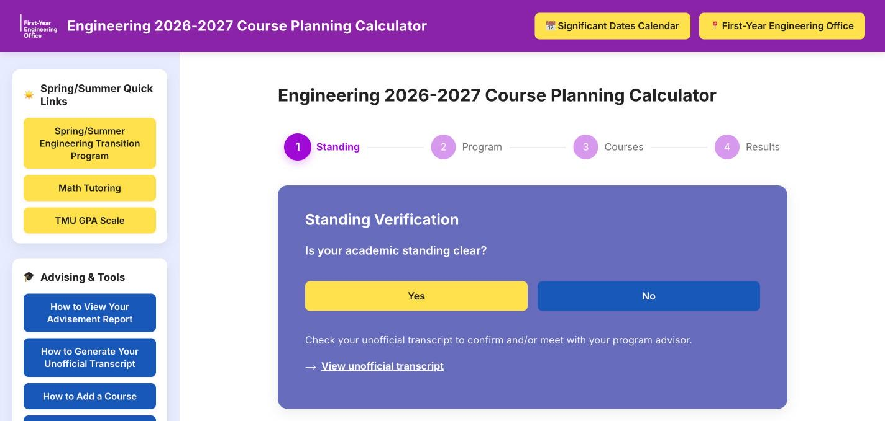
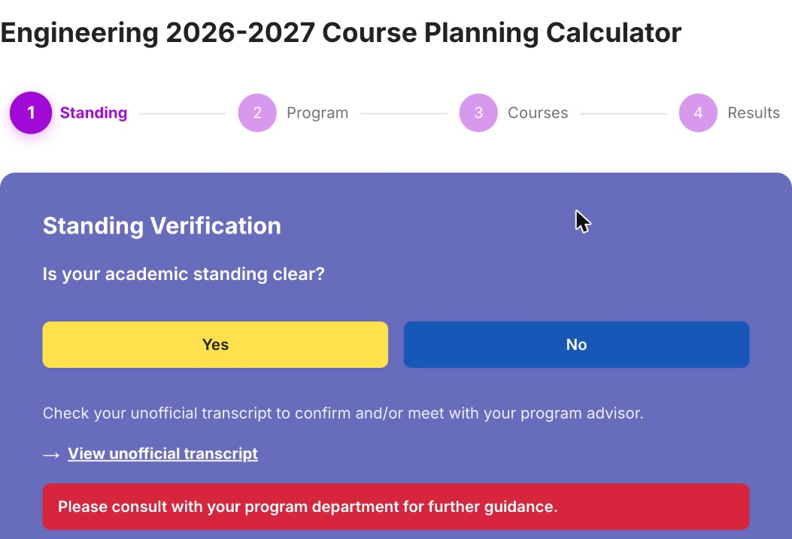
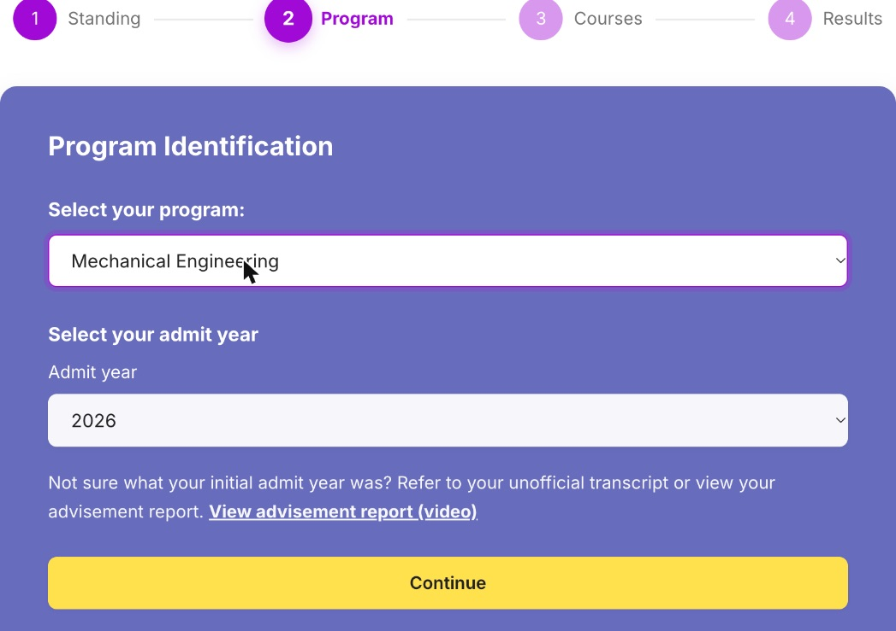
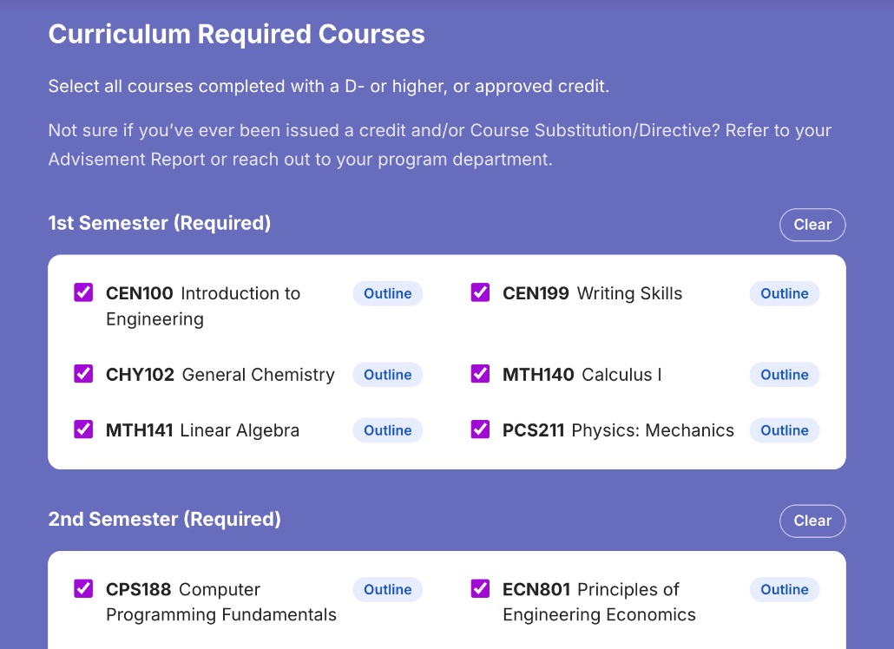
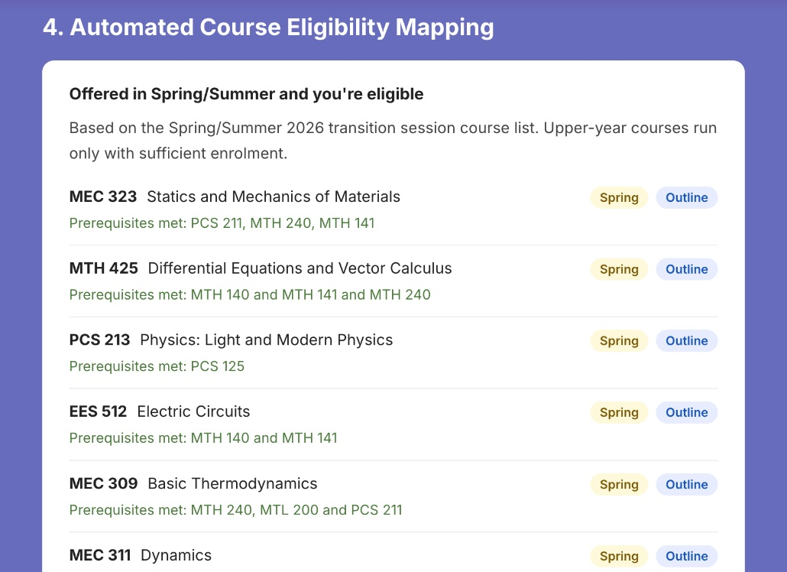
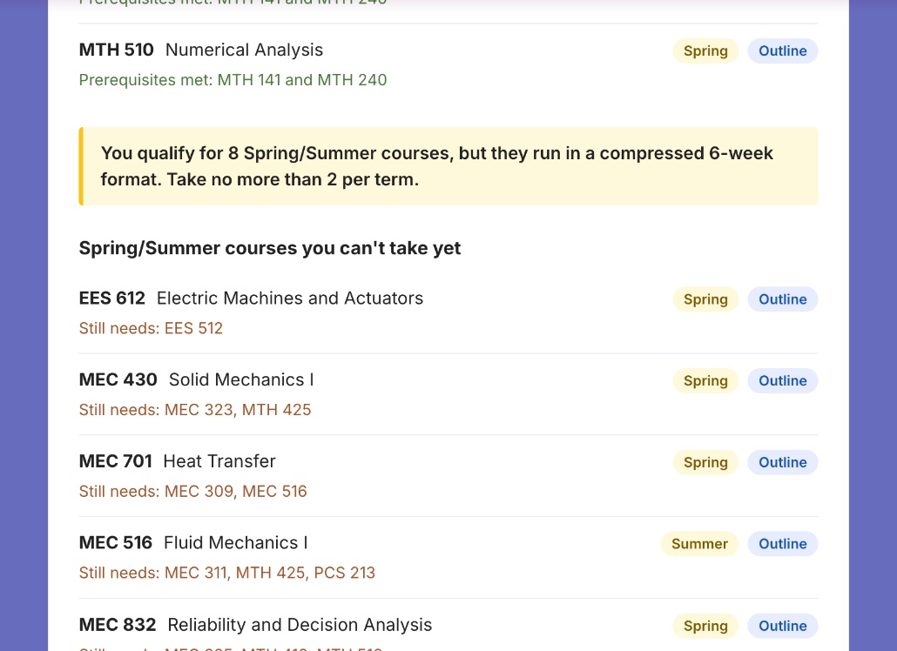
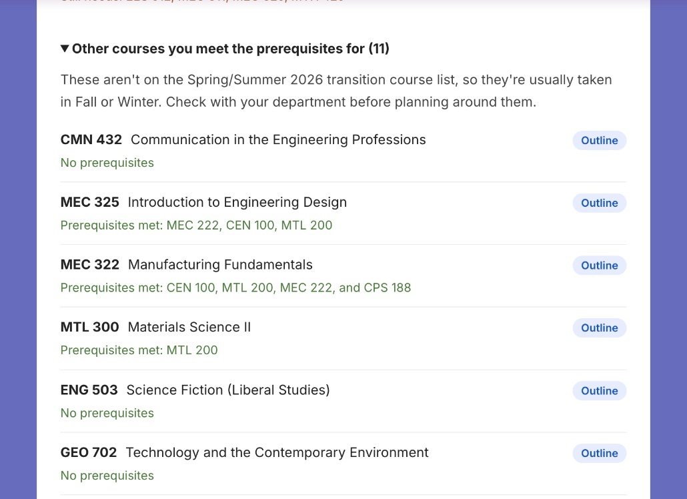

# User guide

How to use the **Engineering 2026-2027 Course Planning Calculator**. This
guide is for students, and for advisors and FYEO staff who help students use
it.

> **What it does:** you tell it your program, your admit year and the courses
> you've completed. It tells you which Spring/Summer courses you can take,
> which ones you can't take yet (and why), and what else you qualify for.

It's a guide, not an official record. Always confirm your plan with your
program department or academic advisor before enrolling.

---

## Contents

- [Before you start](#before-you-start)
- [Step 1: Standing](#step-1-standing)
- [Step 2: Program and admit year](#step-2-program-and-admit-year)
- [Step 3: Completed courses](#step-3-completed-courses)
- [Step 4: Results](#step-4-results)
- [Moving around](#moving-around)
- [The sidebar](#the-sidebar)
- [What the site remembers](#what-the-site-remembers)
- [FAQ](#faq)

---

## Before you start

Have these ready:

- **Your unofficial transcript.** It shows your academic standing and the
  courses you've passed. ([How to generate it](https://www.torontomu.ca/myservicehub-support/students/academics/unofficial-transcript/))
- **Your advisement report,** if you're not sure of your admit year or whether
  you've received transfer credits. ([How to view it](https://www.youtube.com/watch?v=hTO9H4SxP4s))

The site works on phones, tablets and computers. There's nothing to install
or sign in to.

The four steps are shown across the top of the page. The current step is
highlighted in purple:

```
 (1) Standing ─── (2) Program ─── (3) Courses ─── (4) Results
```



---

## Step 1: Standing

**"Is your academic standing clear?"**

- **Yes**: go to Step 2.
- **No**: a red message asks you to consult your program department. The
  calculator can't plan around probationary or other standings, because those
  come with conditions only your department can set. If you answered No by
  mistake, just click **Yes**.



Not sure? Check your standing on your unofficial transcript (link under the
buttons).

---

## Step 2: Program and admit year

1. **Select your program.** Programs with a separate option have their own
   entry, for example *Civil Engineering (Structural Option)* or *Computer
   Engineering (Software Engineering Option)*. If you haven't chosen a program
   yet, pick *Undeclared Engineering*.
2. **Select your admit year**, the year you **first started** your program,
   not your current year. The list only shows the years available for the
   program you picked, and defaults to the most recent one.
3. Click **Continue**.



The site remembers the program you picked last time on the same device and
selects it for you.

---

## Step 3: Completed courses

You'll see your program's full curriculum, grouped by semester. For each
course you'll see its code (in bold), its title, and an **Outline** link.

**Tick every course you've completed with a D- or higher, or received credit
for.** Leave everything else unticked, including courses you're taking right
now.

Shortcuts:

- **Select all** next to a semester ticks every course in it. Once they're all
  ticked, the button changes to **Clear**, which unticks them.
- The line above the button shows your progress, for example
  **"14 of 61 courses selected"**.
- **Outline** opens that course's page in the TMU undergraduate calendar in a
  new tab: description, prerequisites, antirequisites and weekly hours.
  Clicking it doesn't tick the course.



Some entries are notes rather than single courses, such as *Core electives
(see Table II)*. You can tick them to keep track, but they aren't used in the
results.

When you're done, click **Calculate Spring/Summer Eligibility**.


---

## Step 4: Results

The results page has up to three groups. Every course shows its title and
**Outline** link, and a line explaining the result.

### 1. Offered in Spring/Summer and you're eligible

Courses on the FEAS Spring/Summer transition-session list whose prerequisites
you've met. Each one has a label showing when it runs:

| Label | When |
|---|---|
| **Spring** | Second week of May to the end of June |
| **Summer** | Early July to late August |
| **Spring or Summer** | Offered in both terms |

The green line lists the prerequisites you've met, or says *No prerequisites*.



If more than two courses qualify, a yellow note reminds you that Spring/Summer
courses run in a **compressed 6-week format** and you should **take no more
than 2 per term**.

If none qualify, you'll see one of these instead:

- *You've already completed every Spring/Summer course in your curriculum*
- *None of the Spring/Summer courses in your curriculum are available to you
  yet* (see the next group for what's missing)
- *None of your curriculum's remaining courses are offered in Spring/Summer*

### 2. Spring/Summer courses you can't take yet

Spring/Summer courses you **don't** have the prerequisites for yet. The orange
**"Still needs:"** line lists exactly which courses are missing, so you can
see what to take first. Courses missing the fewest prerequisites are listed
first.



### 3. Other courses you meet the prerequisites for

Collapsed by default. Click it to expand. These are courses you qualify for
that **aren't** on the Spring/Summer list, so they're usually taken in Fall or
Winter.



### Course load guidance

Below the results, a reminder about the compressed Spring/Summer format.

### Printing or saving your results

Click **Print / save as PDF**. The printout contains only your results and the
guidance: no header, sidebar or buttons. The "Other courses" group is
expanded automatically. To get a PDF, choose **Save as PDF** as the printer.
This is handy to bring to an advising appointment.

### Important caveats

- The Spring/Summer list is copied from the most recent published transition
  session (the results say which one). **Upper-year courses only run with
  sufficient enrolment**, and offerings can change.
- Only **prerequisites** are checked. Corequisites, antirequisites and program
  restrictions aren't. Check the course's Outline page.
- Results are only as accurate as the courses you tick.

---

## Moving around

- **← Back** (top left of the page) goes back one step.
- Your **browser's Back and Forward buttons** do the same: they move between
  steps instead of leaving the site.
- Going back doesn't lose your ticks. Change something and calculate again as
  often as you like.

---

## The sidebar

On phones the sidebar appears **below** the calculator.

| Section | Links |
|---|---|
| **Spring/Summer Quick Links** | Spring/Summer Engineering Transition Program, Math Tutoring, TMU GPA Scale |
| **Advising & Tools** | How to view your advisement report, how to generate your unofficial transcript, how to add a course, additional Spring/Summer supports |
| **FYEng Mobile App** | Pick App Store or Google Play to download the app |

The yellow buttons in the purple header open the **Significant Dates
Calendar** and the **First-Year Engineering Office** website.

All links open in a new tab.

---

## What the site remembers

Nothing is sent anywhere. Everything stays in your own browser.

| What | How long |
|---|---|
| The program you last picked | On that device and browser, until you clear your browsing data |
| The courses you ticked | Until you close the **tab**. Refreshing or going back keeps them. |

Because ticks disappear when the tab is closed, it's safe to use on shared or
library computers.

---

## FAQ

**My program or admit year isn't in the list.**
Only the programs and admit years with curriculum data are listed. Contact
your program department.

**I received a transfer credit or course substitution.**
Tick the course you received credit for. Your advisement report lists
credits and substitutions.

**A course I need isn't showing as eligible.**
Click its **Outline** link to check its prerequisites, and make sure you've
ticked every prerequisite you've completed. If it's in "can't take yet", the
"Still needs" line tells you what's missing.

**A course says "Spring" but isn't in the timetable.**
Upper-year courses run only with enough enrolment, and the list may be from
the previous year. Check with your department.

**I'm seeing an old version of the page.**
Hard-refresh: **⌘⇧R** (Mac) or **Ctrl+Shift+R** (Windows).

**Who do I contact?**
First-year students: the [First-Year Engineering Office](https://www.torontomu.ca/first-year-engineering-office/).
Upper-year students: your program department.
